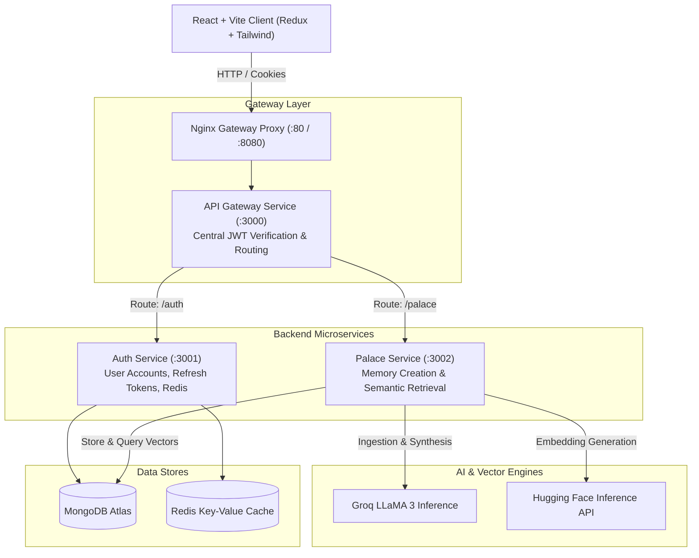
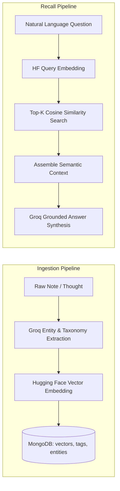

# Memory Palace

> Personal knowledge base and semantic associative recall engine built with microservices, Hugging Face vector embeddings, Groq LLM extraction, and Nginx reverse proxies.

[](https://react.dev/)
[](https://nodejs.org/)
[](https://expressjs.com/)
[](https://www.mongodb.com/)
[](https://redis.io/)
[](https://www.docker.com/)
[](https://nginx.org/)
[](https://huggingface.co/)
[](https://groq.com/)

---

## Overview

Traditional note-taking tools require rigid folder structures and manual tags that quickly become unorganized. When you need to retrieve something, keyword search fails if you remember the concept rather than the exact phrasing.

I built **Memory Palace** as an associative second brain inspired by the classical Method of Loci:
- **Zero-Friction Ingestion**: Dump unformatted notes or thoughts. The ingestion pipeline summarizes, categorizes, and extracts entities using Groq, then computes dense vector embeddings with Hugging Face.
- **Associative Semantic Recall**: Ask natural-language questions to retrieve top-k semantically relevant notes and synthesize a grounded answer with citations to original entries.

---

## Preview


---

## Architecture



---

## Pipeline



---

## Key Highlights

- **Structured Ingestion**: Constrained JSON prompts extract clean summaries, taxonomy tags, and named entities from raw text.
- **Semantic Retrieval**: Encodes queries into 384-dimensional dense vectors and performs top-k cosine similarity queries in MongoDB scoped to the user ID.
- **Containerized Microservices**: Independent Docker and Nginx reverse proxies for `api-gateway`, `auth-service`, and `palace-service`.
- **Session Security**: Stateless short-lived JWT access tokens paired with refresh token rotation and Redis-backed revocation.

---

## Tech Stack

- **Frontend**: React 18, Vite, Redux Toolkit, Tailwind CSS, Lucide Icons
- **Backend**: Node.js, Express 5 (ES Modules)
- **AI & NLP**: Groq SDK (`llama-3`), Hugging Face Inference API (`@huggingface/inference`)
- **Databases**: MongoDB (Mongoose with vector fields), Redis (session cache and token blacklist)
- **Infrastructure**: Docker, Docker Compose, Nginx

---

## Setup & Local Run

### 1. Clone & Install
```bash
git clone https://github.com/V-Rytham/Memory-Palace.git
cd Memory-Palace

npm install
npm install --prefix backend/api-gateway-service/service
npm install --prefix backend/auth-service/service
npm install --prefix backend/palace-service/service
npm install --prefix frontend
```

### 2. Environment Variables
Copy `.env.example` templates in each service:

- `backend/auth-service/service/.env`:
  ```ini
  PORT=3001
  MONGO_URI=your_mongodb_uri
  REDIS_HOST=localhost
  REDIS_PORT=6379
  ACCESS_TOKEN_SECRET=your_access_token_secret
  REFRESH_TOKEN_SECRET=your_refresh_token_secret
  ```
- `backend/palace-service/service/.env`:
  ```ini
  PORT=3002
  MONGO_URI=your_mongodb_uri
  HF_TOKEN=your_huggingface_token
  GROQ_API_KEY=your_groq_api_key
  ```
- `backend/api-gateway-service/service/.env`:
  ```ini
  PORT=3000
  AUTH_SERVICE_URL=http://localhost:3001
  PALACE_SERVICE_URL=http://localhost:3002
  ```

### 3. Start Development Services
```bash
npm run dev
```

- Web App: `http://localhost:5173`
- API Gateway: `http://localhost:3000`
